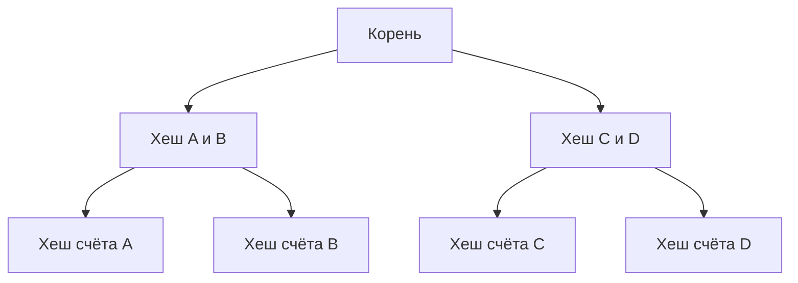
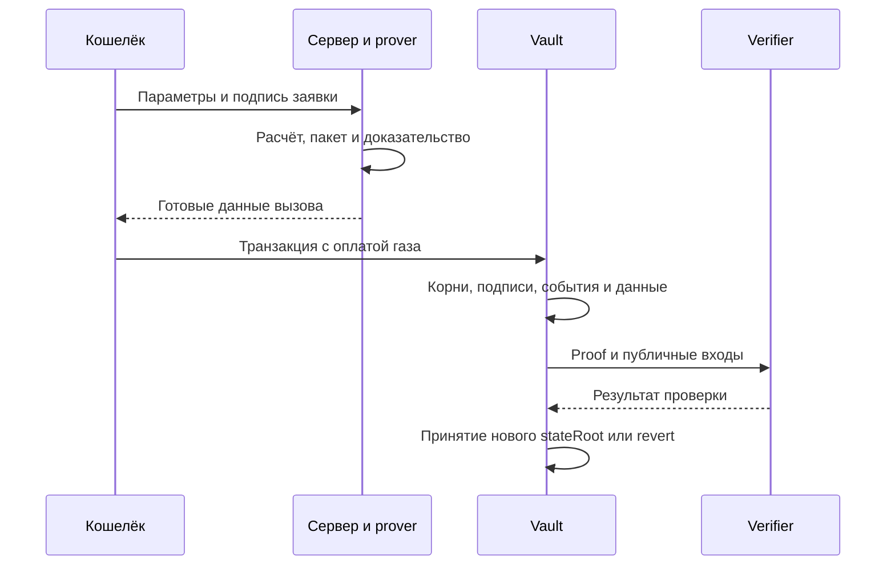

# Как в RUBA работает ZK: объясняем с нуля

Здесь мы на пальцах разбираем, как устроен наш MVP. Структуры настоящие, но примеры кое-где упрощены, так что копировать код отсюда для отправки транзакций не стоит. Настроек Sepolia, ключей и данных реальных пользователей тут нет

С 23.11.2026 без whitelist нельзя зарегистрироваться, внести депозит, сделать своп и добавить ликвидность. Забрать свои LP-доли и вывести деньги можно и без него. Новые проверки регистрации и депозита живут в контракте, поэтому для них нужен новый Vault: старые контракты неизменяемые, обновление сайта или сервера их не меняет. Старые базы и деньги сами не переезжают

## 1. Что такое stateRoot

`stateRoot` - это один хеш, в котором зашито всё состояние нашего внутреннего учёта: какие есть счета, сколько на них токенов, какие резервы у AMM и какие внешние переводы уже учтены

Состояние - это снимок данных в конкретный момент. Например: у Алисы 100 RUBA, у Бориса 20 USDT, в резерве AMM 1 000 RUBA и 1 000 USDT. После обмена состояние становится другим

Хеш - это короткий отпечаток данных. Одни и те же данные всегда дают один и тот же хеш, а если поменять хоть что-то, хеш почти наверняка станет другим. При этом по хешу нельзя узнать балансы или восстановить базу

В проекте общий отпечаток считается так:

```ts
const stateRoot = hashState(
  domain,
  accountsRoot,
  poolHash,
  inboxCursor,
  nextTradeId,
  poolKeyCommit,
);
```

Контракт хранит принятый `stateRoot`. Когда сервер предлагает новый, контракт требует доказательство того, что из текущего состояния по нашим правилам действительно получается новое

Просто прислать новый хеш мало: посчитать хеш от выдуманных данных сервер может легко. ZK-доказательство как раз и проверяет, что изменения допустимы

### Что значат шесть параметров

| Параметр | Простое объяснение | Зачем включён |
|---|---|---|
| `domain` | Идентификатор конкретной системы учёта | Привязывает состояние к сети, Vault, токенам и версии |
| `accountsRoot` | Корень дерева всех внутренних счетов этого Vault | Фиксирует личные балансы, LP-доли и служебные поля счетов |
| `poolHash` | Хеш состояния AMM и учтённой обеспеченности | Фиксирует резервы, общее количество LP-долей и custody |
| `inboxCursor` | Номер последнего внешнего события, уже включённого во внутреннее состояние | Не даёт повторно зачислять или пропускать депозиты и выплаты |
| `nextTradeId` | Номер, который получит следующий своп | Фиксирует порядок и нумерацию сделок |
| `poolKeyCommit` | Хеш ключа шифрования состояния пула | Не позволяет незаметно заменить ключ, используемый для публикации данных пула |

`domain` - это не адрес сайта. Он считается из версии схемы, `chainId`, адреса Vault, адресов двух токенов и `poolKeyCommit`. Поэтому состояние RUBA/USDT из одного Vault нельзя просто перенести в другой

`poolHash` - это не дерево счетов. Даже если личные балансы скрыты, резервы, по которым считается цена, всё равно надо зафиксировать, иначе сервер мог бы подставить любую ликвидность

`inboxCursor` проще понять на примере очереди событий контракта:

| Номер | Реальное событие |
|---:|---|
| 1 | Алиса внесла 100 RUBA |
| 2 | Борис внёс 20 USDT |
| 3 | Алисе выплачены 5 USDT |

Если в состоянии учтены только события 1 и 2, то `inboxCursor = 2`. Событие 3 в контракте уже может быть, но в доказанное состояние ещё не попало, и следующим обрабатывается именно оно. Регистрации и обычные свопы cursor не двигают

`nextTradeId` - это номер следующего свопа, а не число всех транзакций. До первого свопа он равен 1, после свопов 1, 2, 3 и 4 становится 5

`poolKeyCommit` относится к ключу пула. Ниже встретится похожее поле `recoveryKeyCommit`, но это ключ конкретного счёта пользователя, не путайте их

В `stateRoot` попадает не всё. Whitelist и паузы контракт проверяет сам, отдельно. Версия перехода `stateVersion` и корень квитанций `receiptsRoot` тоже передаются отдельно: с доказательством они связаны, но в шесть аргументов `hashState` не входят

## 2. Где хранятся деньги и где находятся балансы

Настоящие ERC-20 лежат на адресе Vault, а сервер ведёт учёт, кому из них сколько принадлежит

Например, в Vault 1 100 RUBA. По учёту 1 000 из них - резерв AMM, а 100 принадлежат Алисе. Для этого не нужны два адреса или два перевода ERC-20, но протокол должен уметь доказать, где чья часть

Обычный своп только перераспределяет права. Настоящий перевод ERC-20 происходит лишь при депозите или выплате из Vault

У каждого пула свой Vault и своё состояние. Депозит в RUBA/USDT не даст баланса в RUBA/WETH. Ниже для простоты пишем RUBA и USDT, в других парах это просто первый и второй токен

## 3. Что находится в счёте пользователя

Счёт - это запись из девяти полей:

```ts
const account = [
  owner,
  rubaBalance,
  usdtBalance,
  lpShares,
  spendNonce,
  pendingRuba,
  pendingUsdt,
  recoveryKeyCommit,
  salt,
];
```

| Поле | Значение |
|---|---|
| `owner` | Адрес кошелька, чьи подписи разрешают операции |
| `rubaBalance` | Доступные пользователю RUBA, которые можно обменять или зарезервировать к выводу |
| `usdtBalance` | Аналогичный доступный баланс USDT |
| `lpShares` | Внутренние LP-доли пользователя: право на соответствующую часть резервов AMM |
| `spendNonce` | Счётчик подписанных экономических операций, защищающий от повторного исполнения |
| `pendingRuba` | RUBA, уже исключённые из доступного баланса и зарезервированные для выплаты |
| `pendingUsdt` | Аналогичная зарезервированная сумма USDT |
| `recoveryKeyCommit` | Хеш ключа, которым шифруются обновления этого счёта |
| `salt` | Случайное значение, обновляемое при изменении счёта |

`pending` тут значит не «своп ещё не опубликован», а именно деньги, отложенные на вывод. Статус перехода, который сеть ещё не приняла, хранится отдельно

`spendNonce` работает как нумерация разрешений: если операция со старым nonce уже принята, повторить её не выйдет. Это не Ethereum nonce кошелька и не nonce HTTP-запросов

`salt` нужен, чтобы при похожих балансах хеши не повторялись и их нельзя было угадать. Паролем к деньгам он не является

## 4. Что такое ключ восстановления

Ключ восстановления - отдельный секрет, которым расшифровываются опубликованные данные счёта. Это не сид-фраза и не приватный ключ Ethereum

Браузер получает его из подписи специального сообщения, в котором указаны сеть, Vault и владелец. Потом считается:

```ts
const recoveryKeyCommit = keyCommit(recoveryKey);
// В проекте: Poseidon(109, recoveryKey).
```

Число 109 - просто служебная метка. Хеш ключа записывается в счёт при регистрации, и ZK-схема проверяет, что обновления шифруются ключом именно с этим хешем. Поменять ключ после регистрации сейчас нельзя

Сейчас ключ лежит в браузере в `localStorage`, отправляется на сервер и хранится в SQLite в таблице `zk_keys`. Ещё он попадает в резервную копию. На сервере он хранится без дополнительного шифрования

Серверу ключ нужен, чтобы собрать witness и зашифровать обновления. То есть от самого сервера данные сейчас не скрыты. Читать данные по ключу можно, но для любой новой операции с деньгами всё равно нужна подпись кошелька владельца

Отдельный `poolRecoveryKey` шифрует состояние пула. Его хеш `poolKeyCommit` привязывается к Vault при создании. Подписывать операции пользователей этот ключ не позволяет

## 5. Что находится в состоянии пула

```ts
const pool = [
  reserveRuba,
  reserveUsdt,
  totalSupply,
  lockedLiquidity,
  custodyRuba,
  custodyUsdt,
];
```

| Поле | Значение |
|---|---|
| `reserveRuba` | RUBA, участвующие в ликвидности AMM |
| `reserveUsdt` | USDT, участвующие в ликвидности AMM |
| `totalSupply` | Все выпущенные внутренние LP-доли, включая заблокированные |
| `lockedLiquidity` | Навсегда заблокированные LP-доли первоначальной эмиссии |
| `custodyRuba` | Общее учтённое обеспечение RUBA для резервов, личных балансов и зарезервированных выплат |
| `custodyUsdt` | То же самое для USDT |

Если у вкладчика 10% от `totalSupply`, при погашении он получит примерно 10% каждого резерва AMM с округлением вниз. Чужие личные балансы в его долю не входят

При первом вкладе блокируются 1 000 минимальных единиц LP-долей. Это не 1 000 RUBA и не 1 000 целых долей, а совсем немного. Первый вкладчик получает всё остальное. Заблокированные доли входят в `totalSupply`, и забрать их никто не может

По каждому токену всегда выполняется равенство:

```text
custody = резерв AMM
        + сумма доступных личных балансов
        + сумма зарезервированных выплат
```

`custody` считается по событиям, которые уже вошли в состояние. С текущим `balanceOf(Vault)` оно может не совпадать: бывают ещё не обработанные депозиты или случайные переводы, которые не дают личного баланса

## 6. Как счёт превращается в дерево Меркла

Сначала считаем хеш одного счёта, это лист дерева:

```ts
const leaf = hashAccount(slot, account);
```

`slot` - номер места счёта, сейчас от 0 до 15. В хеш входят номер места и все девять полей

Потом хеши склеиваются попарно: `Poseidon(левый, правый)`, и так до одного верхнего хеша `accountsRoot`. Порядок важен, левый и правый местами менять нельзя



Здесь глубина 2: от счёта до корня два шага, мест четыре. При глубине 4 мест 16, каждый уровень удваивает число листьев: 2, 4, 8, 16. В промежуточных узлах только хеши, это не отдельные счета

Merkle-путь счёта A в примере - это хеш B и хеш ветви C-D. Зная их и хеш A, можно пересчитать корень и не видеть, что в других счетах. В нашем дереве путь из четырёх соседних хешей

Так доказывается, что счёт есть в дереве. Правильность свопа это ещё не доказывает, для неё нужны условия ZK-схемы

Регистрация занимает свободный слот. В каждом Vault она своя, и владельцу нужен whitelist. LP и бот тоже занимают слоты. Whitelist к размеру дерева отношения не имеет: он только ограничивает регистрацию, депозиты, свопы и добавление ликвидности. Если допуск отозвали, владелец всё равно может смотреть баланс, забрать свои LP-доли и вывести деньги. Пауза рынка останавливает депозиты, свопы и добавление LP, а регистрацию нет

## 7. Хеш, шифрование, подпись и ZK - разные вещи

| Механизм | Что делает | Чего сам по себе не делает |
|---|---|---|
| Хеш | Фиксирует содержимое данных цифровым отпечатком | Не позволяет восстановить данные и не доказывает правильность расчёта |
| Шифрование | Позволяет скрыть данные и прочитать их с ключом | Не доказывает, что скрытые данные экономически правильные |
| Подпись кошелька | Подтверждает согласие владельца на конкретное сообщение | Не доказывает правильность формулы AMM |
| Merkle-путь | Связывает один лист с известным корнем | Не проверяет все правила изменения баланса |
| ZK-доказательство | Подтверждает выполнение заданных условий, не раскрывая скрытые входы проверяющему | Не гарантирует доступность сервера и не исправляет ошибочные условия схемы |

Работают они вместе: хеш дерева фиксирует данные, подпись разрешает операцию, а ZK проверяет, что переход к новому состоянию правильный

## 8. Что пользователь подписывает

Продолжим пример: у Алисы 100 RUBA, она хочет отдать 10 RUBA и получить минимум 9 USDT

Браузер собирает параметры: направление, сумму на входе и минимум на выходе, и сам считает хеш заявки, commitment:

```ts
const commitment = hashOperation(
  domain, kind, slot, owner,
  oldSpendNonce, params, newSalt,
);
```

`kind` - вид операции, для свопа это 3. `params` - параметры операции. `newSalt` - новое случайное значение. Остальное уже разобрали выше

Кошелёк подписывает commitment как сообщение EIP-712, привязанное к сети и Vault. Транзакция при этом не отправляется, газ не тратится

Подписывается конкретная заявка, а не разрешение серверу делать с балансом что угодно. Если заменить 10 RUBA на 50, commitment изменится, и старая подпись к новой операции уже не подойдёт

Сервер получает параметры и подпись по HTTP и сейчас видит их в открытом виде

## 9. Как сервер считает обмен

В пуле 1 000 RUBA и 1 000 USDT, на вход идут 10 RUBA. Считаем с комиссией 0,3% и округлением вниз

```ts
const RUBA = 10n ** 18n;
const USDT = 10n ** 6n;
const amountIn = 10n * RUBA;
const reserveIn = 1000n * RUBA;
const reserveOut = 1000n * USDT;

const numerator = amountIn * 997n * reserveOut;
const denominator = reserveIn * 1000n + amountIn * 997n;
const amountOut = numerator / denominator;
// 9_871_580 минимальных единиц USDT = 9.871580 USDT.
```

Суффикс `n` значит, что это целое число `BigInt`. Токены считаются в минимальных единицах: у RUBA 18 знаков после запятой, у USDT 6. Дробных чисел в расчёте нет вообще

| Запись | До | После |
|---|---:|---:|
| Личные RUBA Алисы | 100 | 90 |
| Личные USDT Алисы | 0 | 9,871580 |
| RUBA в AMM | 1 000 | 1 010 |
| USDT в AMM | 1 000 | 990,128420 |

Всего в Vault по-прежнему 1 100 RUBA и 1 000 USDT. USDT, которые получила Алиса, из резерва AMM ушли. Настоящего перевода ERC-20 при таком свопе нет

Произведение резервов после свопа немного растёт, потому что комиссия остаётся в пуле. Схема проверяет точную формулу с коэффициентом 997/1000 и округлением

## 10. Что именно доказывает схема

Сервер собирает старый и новый счёт, путь в дереве, старые и новые резервы, подписанные параметры и промежуточные результаты

Circom - язык, на котором записывают математические условия. У нас они описывают, какой переход состояния допустим. `===` значит, что равенство обязано выполняться

Проверки цепляются друг за друга:

1. Старый счёт с предоставленным Merkle-путём должен давать текущий корень счетов
2. Старый корень счетов и старое состояние пула должны давать ожидаемый общий `stateRoot`
3. Хеш скрытых параметров операции должен совпадать с опубликованным commitment
4. Результат обмена должен соответствовать формуле
5. Изменения личного баланса и резервов должны соответствовать этому результату
6. Новый баланс не может быть отрицательным, и все числа должны быть в допустимых диапазонах
7. Выход не должен быть меньше подписанного `minOut`
8. Для свопа nonce увеличивается на единицу, владелец и ключ счёта остаются прежними
9. Новый счёт шифруется правильным ключом, а публикуемые шифротексты соответствуют доказанным данным

Верить серверу на слово при целочисленном делении нельзя, поэтому проверяем:

```circom
numerator === quotient * denominator + remainder;
```

Ещё знаменатель должен быть положительным, а остаток от нуля до `denominator - 1`. Тогда `quotient` точно равен результату с округлением вниз, и начислить 20 USDT вместо 9,871580 сервер не сможет

Старый и новый хеш счёта проверяются с одними и теми же соседними ветвями. Так меняется только выбранный лист и хеши на пути к корню, а остальные ветви остаются как были. Чтобы поменять ещё один счёт, нужна отдельная доказанная операция

Подпись ECDSA проверяет контракт на Solidity, а не Circom. Схема доказывает, что commitment соответствует скрытым параметрам, а контракт проверяет, что владелец подписал именно его. Вместе это даёт и согласие пользователя, и правильный расчёт

## 11. Почему корень не публикуется после каждого свопа

Сервер считает промежуточное состояние после каждой операции, а публикует от одного до четырёх свопов за раз. Четвёртый закрывает пакет сам, раньше его может закрыть админ, а ещё запрос на вывод или снятие LP

Первый своп может поменять счёт Алисы, второй Бориса, третий и четвёртый снова Алисы. Каждый расчёт опирается на предыдущий, считать все четыре по одной начальной цене нельзя

Торговый переход доказывает цепочку из 1-4 свопов. Мест для операций в схеме восемь, так что туда же могут попасть и другие действия. Свободные места заполняются пустыми операциями, которые ничего не меняют

Есть и переходы без свопов, например для регистрации или депозитов. Если перед ними нет незакрытого торгового пакета, четыре свопа для них собирать не надо, но доказательство всё равно нужно. Если в очереди уже 1-3 свопа, новые действия через них не перепрыгивают. Запрос на вывод или снятие LP закрывает этот хвост, админ может сделать то же своей командой. Дальше переходы публикуются по порядку, четвёртого свопа никто не ждёт

«Сервер принял операцию» и «контракт принял новое состояние» - разные вещи. 1-3 свопа могут ждать ручного закрытия или запроса на выход, таймера нет. Пока они ждут, в сети их результат не подтверждён

## 12. Что получает prover

Prover - программа, которая строит доказательство. У нас это код на сервере с библиотекой snarkjs и схемой Groth16

На вход он получает witness: скрытые данные и промежуточные вычисления. Там счета, резервы, параметры операций, Merkle-пути и ключи шифрования. Приватных ключей от кошельков там нет

Ещё есть публичные входы, их видит проверяющий:

| Публичные поля | Что фиксируют |
|---|---|
| `domain`, `poolKeyCommit` | Привязку к конкретному Vault и ключу пула |
| `stateVersion` | Номер доказуемого перехода, увеличиваемый на один |
| `mode` | Торговый переход с 1-4 свопами или переход без свопов |
| `previousRoot`, `newRoot` | Старый и новый общий `stateRoot` |
| Старый и новый `inboxCursor` | Какие внешние события обработаны |
| Старый и новый счётчик сделок | Значения `nextTradeId` на границах перехода |
| `receiptsRoot` | Корень четырёхместного дерева: 1-4 квитанции и нулевые отсутствующие листья |
| `authDigest` | Общий хеш упорядоченных метаданных операций |
| `daDigest` | Общий хеш публикуемых данных для восстановления |

Всего их 13. `authDigest` связывает скрытые расчёты с метаданными и commitment, которые видит контракт, а `daDigest` связывает доказательство с шифротекстами и хешами из транзакции. Подсунуть другие данные со старым доказательством не выйдет

## 13. Как получается настоящее доказательство

Кусок нашего prover, немного сокращённый:

```ts
const generated = await snarkjs.groth16.fullProve(
  JSON.parse(canonical(witness)),
  this.wasmPath,
  this.zkeyPath,
);
```

`canonical(witness)` тут просто приводит данные, в том числе большие числа, к нужному формату. Это ещё не доказательство

`.wasm` - скомпилированная программа, которая считает witness. `.zkey` - параметры для построения доказательства под нашу схему, к кошелькам он отношения не имеет. На выходе получаем `proof` и `publicSignals`

`proof` - это несколько объектов Groth16. Он подтверждает, что существует witness, который удовлетворяет всем условиям. Самих скрытых балансов в нём нет

Для проверки нужен verification key. Из него же сгенерирован verifier на Solidity. Поменять формулу в Circom и пройти проверку старым verifier не получится

ZK гарантирует только то, что записано в схеме. Если мы ошиблись в самих правилах, ZK это не исправит. И setup у нас пока тестовый, а не настоящая церемония для production

## 14. Кто отправляет транзакцию и что проверяет контракт

Когда пакет готов, сервер отдаёт данные вызова, а кошелёк пользователя отправляет транзакцию и платит за газ:

```ts
await vault.publishProvenTransition(
  publicSignals,
  operations,
  accountDA,
  poolDA,
  proof,
);
```

В `operations` публичные метаданные и подписи, в `accountDA` хеши изменённых счетов и зашифрованные обновления, в `poolDA` хеш и зашифрованное состояние пула. Это нужно для восстановления, весь witness туда не попадает



Опубликовать верный пакет может любой адрес, подпись админа не нужна. Чужие счета отправителю от этого не достаются. Для регистрации, свопа и добавления LP контракт проверяет whitelist владельца операции, а не того, кто платит. Для нового депозита whitelist проверяется прямо в deposit. Уже принятый депозит учитывается и после отзыва допуска, иначе эти деньги нельзя было бы вывести

Сначала контракт сверяет старый корень со своим `stateRoot`, проверяет номер версии, подписи владельцев, события inbox и опубликованные данные. Потом вызывает:

```solidity
verifier.verifyProof(proof.a, proof.b, proof.c, signals)
```

Verifier не пересчитывает скрытые свопы, а проверяет криптографию. Если proof неверный, транзакция откатывается. Если всё сошлось, Vault сохраняет новый корень и счётчики

## 15. Зачем нужно второе дерево квитанций

Дерево счетов показывает, у кого сколько сейчас. А дерево квитанций подтверждает историю конкретного пакета из 1-4 свопов. В нём четыре места, пустые листья нулевые и сделками не считаются

В квитанции владелец, номер сети и сделки, Vault, токены, суммы на входе и выходе, комиссия, резервы до и после и salt. Её хеш - лист дерева квитанций. Из четырёх листьев получается корень `receiptsRoot`, глубина дерева два

ZK-схема связывает квитанции с доказанными свопами. Потом владелец может раскрыть одну квитанцию и два соседних хеша из её пути, а проверяющий пересчитает корень и сверит его с опубликованным пакетом

Опубликовать корень не значит раскрыть все сделки. Но кое-что всё равно можно понять по остальным публичным данным

## 16. Что видно снаружи и что происходит при взломе Web2

В proof нет личных балансов и сумм свопов. Но сервер и prover их знают, как и ключи просмотра, так что если базу сервера украдут, эти данные утекут

В сети видны адреса владельцев и отправителя, слоты, виды операций, подписи, commitment, корни и шифротексты. Суммы депозитов и выплат тоже видны. А наш демо-dashboard ещё и показывает принятые резервы и цены, по их изменениям можно кое-что понять. Так что анонимность кошельков и полное скрытие сделок мы в MVP не обещаем

Если злоумышленник перепишет базу сервера, правильный proof для выдуманного состояния он всё равно не получит: данные должны сойтись со старым корнем, подписями и правилами схемы. Если схема, контракт и setup правильные, перераспределить чужие деньги так не выйдет

Но сервер может упасть, тормозить с публикациями или потерять данные, и от этого ZK не спасает. То, что ещё не опубликовано, по одной только сети не восстановить

Для вывода деньги сначала резервируются доказанным переходом. После этого контракт хранит право на выплату, и пользователь с сохранённым opening может забрать деньги без оператора и даже без работающего Web2. Забрать можно один раз, и если выплаты токена на паузе, придётся подождать

Одной копии баланса для выплаты мало, для нового резервирования нужен новый proof. Строить переходы совсем без сервера и делать аварийный выход мы пока не умеем

## 17. Где искать соответствующий код

Пути от корня проекта:

| Что смотреть | Файл |
|---|---|
| Формат счёта, пула, корней и операций | `zk/SPEC.md` |
| Вычисление хешей и Merkle-деревьев | `zk/crypto.js` |
| Merkle-путь и целочисленное деление в схеме | `zk/circuits/primitives.circom` |
| Проверки одной операции | `zk/circuits/operation.circom` |
| Объединение операций в доказуемый переход | `zk/circuits/transition.circom` |
| Подготовка входных данных схемы | `zk/schema.ts` |
| Изменение учёта и сборка пакетов | `server/zk/engine.ts` |
| Построение Groth16 proof | `server/zk/prover.ts` |
| Подписи, ключи и публикация из браузера | `ui/client.js` |
| Проверки и принятие состояния контрактом | `src/ZkRubaVault.sol` |
| Криптографическая проверка Groth16 | `src/generated/Groth16Verifier.sol` |
| Текущий протокол вывода | `docs/PROVEN_WITHDRAWALS.md` |

В торговом пакете 1-4 свопа. Из-за этого поменялись ограничения ZK, поэтому в текущем выпуске заново собранные артефакты и новые verifier и Vault. Адреса и состояние Sepolia лежат в [sepolia-v2.json](../deployments/sepolia-v2.json), а старый `sepolia.json` про старые контракты и к новой версии не относится. Старые контракты неизменяемые, их базы и деньги сами не переезжают

Что мы допускаем: админ, prover и тот, кто платит за газ, доступны, таймера нет. Если между записью заявки и публикацией поставили паузу или отозвали whitelist, пакет может стать недопустимым. Автоматически пересобирать такой хвост и отзывать подписи в контракте мы пока не умеем. Закрытие пакета - это не аварийный выход. Подробнее: [PARTIAL_BATCHES.md](PARTIAL_BATCHES.md)
